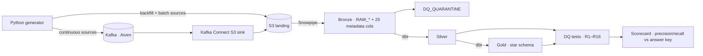
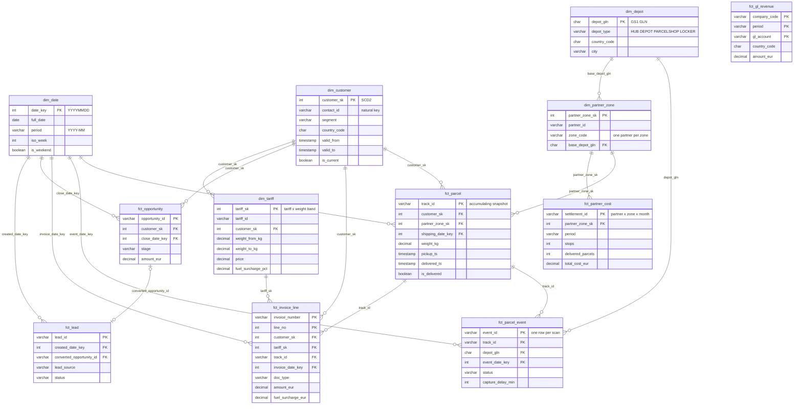

# veloparc-snowflake-dq

Data quality platform for the Sales & Finance data products of **Veloparc**, a fictitious European parcel carrier: 8 sources, Kafka → S3 → Snowflake → dbt, with every data quality rule measured against an answer key of injected anomalies.

> Work in progress. All company names and data in this repository are fictitious.

## Architecture



## Gold data model (star schema)

Seven facts share five conformed dimensions. `dim_customer` is SCD2 (facts point to the customer version valid at the business date); the others are SCD1. Every lookup that fails points to an unknown member (`-1`, or GLN `0000000000000`), so no fact row is dropped.



| Fact | Grain | Type | What it answers |
| --- | --- | --- | --- |
| `fct_parcel` | one row per parcel | accumulating snapshot | Lead time pickup → delivery, delivery rate by zone and customer |
| `fct_parcel_event` | one row per scan | transaction | Network flow per depot, capture delays (timeliness) |
| `fct_invoice_line` | one row per invoice line | transaction | Revenue in EUR by customer, product and month, fuel surcharge |
| `fct_partner_cost` | partner × zone × month | periodic snapshot | Last-mile cost per delivered parcel |
| `fct_gl_revenue` | company × month × GL account | periodic snapshot | Ledger revenue, reconciled with invoices (R13, ±0.5%) |
| `fct_opportunity` | one row per opportunity | accumulating snapshot | Pipeline and won volume by country |
| `fct_lead` | one row per lead | accumulating snapshot | Lead → opportunity conversion by source |

`fct_gl_revenue` and `fct_partner_cost` join `dim_date` on `period` (month grain). The full model is in [`docs/data-model/gold_star_schema.dbml`](docs/data-model/gold_star_schema.dbml) and the column-level lineage in [`docs/data-model/silver_to_gold_mapping.md`](docs/data-model/silver_to_gold_mapping.md).

## What is here today

| Path | Content |
| --- | --- |
| `contracts/schemas/` | JSON Schemas for the 8 sources |
| `contracts/examples/` | 12 valid example payloads that describe one coherent story (customer → shipment → scan → invoice → credit note) |
| `contracts/validate_examples.py` | Validates the examples against the schemas and the cross-source rules R1, R2, R6, R7, R8, R9, R12, R14, R15 |
| `contracts/README.md` | Generation order, cross-source rules R1–R16, anomalies to inject |
| `docs/architecture/` | Ingestion design (Kafka → S3 → bronze) and the phase-by-phase implementation plan |
| `docs/data-model/` | Silver and gold models (DBML) and column-level mappings |
| `generator/` | Synthetic data generator: coherent world, anomalies with an answer key, landing files in the S3 Sink format ([README](generator/README.md)) |
| `docs/adr/` | Architecture decision records |
| `Makefile`, `pyproject.toml`, `.github/workflows/` | Tooling (uv, ruff, pytest, pre-commit) and CI/CD |

## Development

Requires [uv](https://docs.astral.sh/uv/) (it installs Python 3.12 and the pinned dependencies).

```bash
make setup                 # uv sync + git hooks
make lint test validate-contracts
make generate              # 2-month backfill into out/ (see generator/README.md)
```

Every PR runs the same checks in CI. Approving a PR (or labelling it `ready-to-merge`) re-verifies it against the latest `main`, merges it and starts the deploy pipeline: see [ADR 0001](docs/adr/0001-ci-cd-pipeline.md).

Next: Kafka on Aiven (`connect/`), infrastructure (`infra/`) and the dbt project (`dbt/`). See [`docs/architecture/implementation_plan.md`](docs/architecture/implementation_plan.md).

## Licence

MIT
