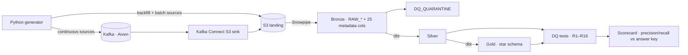

# veloparc-snowflake-dq

Data quality platform for the Sales & Finance data products of **Veloparc**, a fictitious European parcel carrier: 8 sources, Kafka → S3 → Snowflake → dbt, with every data quality rule measured against an answer key of injected anomalies.

> Work in progress. All company names and data in this repository are fictitious.

## What is here today

| Path | Content |
| --- | --- |
| `contracts/` | JSON Schemas for the 8 sources, cross-source rules R1–R16, anomalies to inject |
| `docs/architecture/` | Ingestion design (Kafka → S3 → bronze) and the phase-by-phase implementation plan |
| `docs/data-model/` | Silver and gold models (DBML) and column-level mappings |

Next: the data generator (`generator/`), infrastructure (`infra/`) and the dbt project (`dbt/`). See [`docs/architecture/implementation_plan.md`](docs/architecture/implementation_plan.md).

## Licence

MIT
